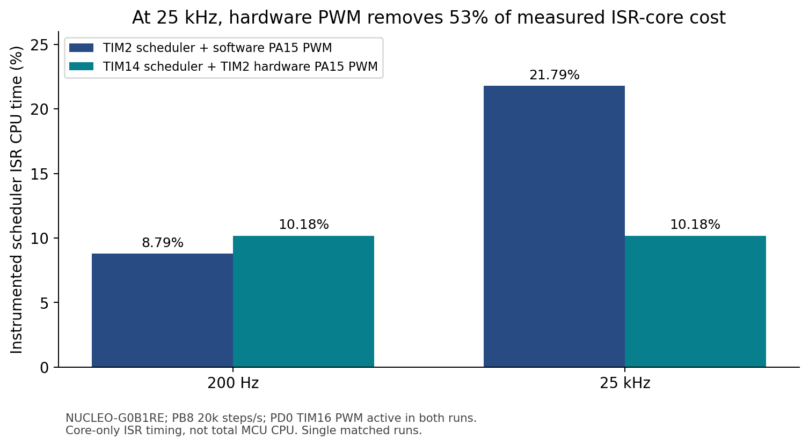
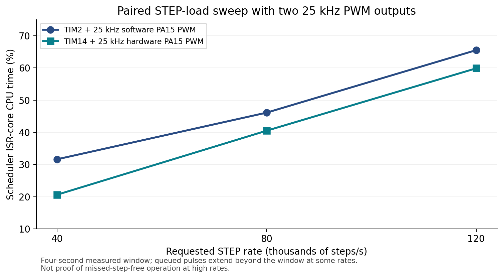
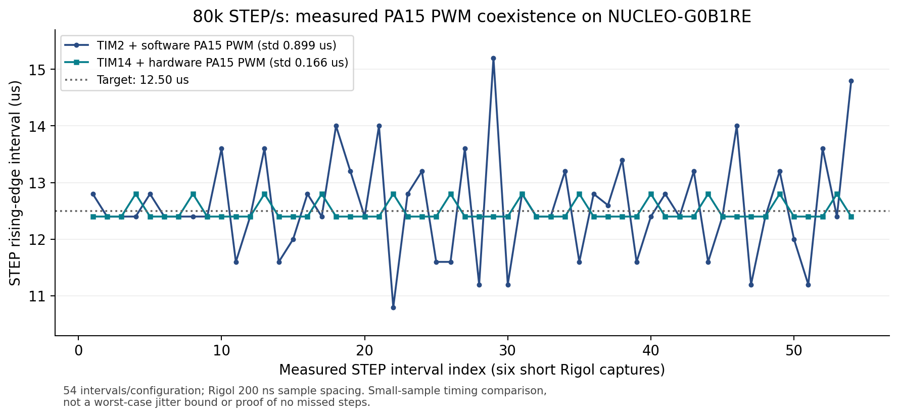
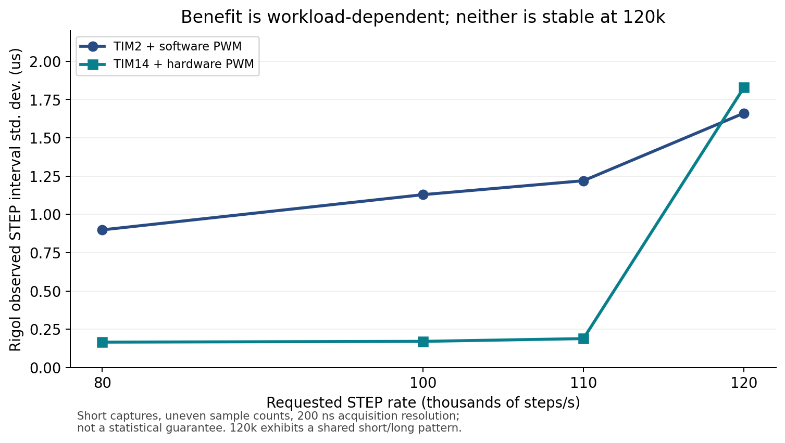

# STM32G0B1 TIM14 scheduler / hardware PWM benchmark evidence

Supporting measurements and figures for
[Klipper PR #7433](https://github.com/Klipper3d/klipper/pull/7433).

**Hardware:** NUCLEO-G0B1RE STM32G0B1 running Klipper on 64 MHz clock;
Rigol DS1202Z-E connected over USBTMC, CH1 PB8 STEP and CH2 PA15 PWM.
Stock comparison: TIM2 scheduler + software PWM PA15.
Modified comparison: TIM14 scheduler + TIM2 hardware PWM PA15.
TIM16 hardware 25 kHz PWM PD0 ran in both test conditions.
No real stepper motor was attached to the development board.

### Figures

### Matched scheduler-core CPU observations
| PA15 PWM | Original TIM2 + software PWM | TIM14 + hardware PWM |
|---|---:|---:|
| 200 Hz at 20k steps/s | 8.79% | 10.18% |
| 25 kHz at 20k steps/s | 21.79% | 10.18% |

For 25k PA15 PWM, measured handler core CPU reduced 11.61 percentage
points (~53%), and approximate IRQ rate from 49,993 to 15,785/s.
At 200 Hz, TIM14 cost more CPU than the default TIM2 scheduler.

For the 25k PA15 PWM and 25k PD0 PWM STEP sweep:
| STEP rate | Original measured core CPU | Modified measured core CPU |
|---|---:|---:|
| 40k/s | 31.62% | 20.61% |
| 80k/s | 46.11% | 40.50% |
| 120k/s | 65.53% | 59.88% |

The high STEP rate test windows were only ~4 seconds and not complete
print emulation. The STM32 MCU was not shutdown in valid trials.

**Rigol STEP edge interval analysis at 80k/s:**
6 short acquisitions, 54 measured intervals in each configuration;
200 ns ADC sample spacing. Original interval std. dev. 0.899 us;
modified 0.166 us. Those are observed samples, not a universal
timing bound. Original range 10.8-15.2 us, modified 12.4-12.8 us.
The exact raw interval values are in [CSV](data/rigol_step_intervals_80k.csv).

At 120k STEP/s, neither implementation maintains uniform spacing;
both display repeated alternating short/long periods. This test does
not show improved high-rate STEP timing at 120k.

**Scope PWM verification:** On NUCLEO physical PA15, 25 kHz output
was 40.0 us period and ~20.0 us high at 50% duty in both software and
hardware cases. The output of the actual Nighthawk SB v2 fan
conditioner/PF- MOSFET circuit was not scoped.

**Real printer validation:** Voron 2.4R2 with Nighthawk SB v2
STM32G0B1 was flashed with TIM14 firmware using Katapult and configured
for 25 kHz TIM2 PA15 fan PWM. Tachometer response:
0% -> 0 RPM; 35% -> 3628 RPM; 50% -> 5757 RPM;
75% -> 8727 RPM; 100% -> 9655 RPM. Preliminary
ABS print endurance test is separate from the NUCLEO scope tests.

**Limitations:** ISR core-only timing via TIM7 excludes interrupt
entry/exit overhead and unrelated MCU work. Short test samples are
not statistically independent. Initial serial retransmits
(9 bytes) were seen in both configurations and are not attributed
to PWM. No scope-based missed-step count was performed. Results
do not imply acoustic fan noise improvement or applicability to
other boards with different PA15 functions.

The original acquisition JSON and complete engineering log were
recorded on the test host; graphs are reproducible from the
numeric inputs in scripts/plot_benchmarks.py.
